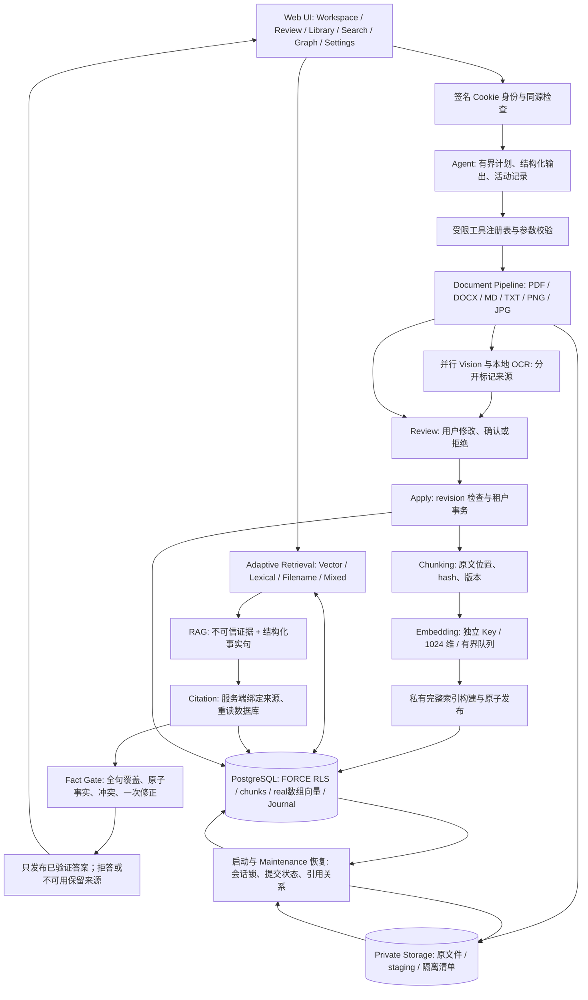

# FileMind AI 系统架构（Phase 8）

FileMind 将分散的学习资料变成可审阅、可检索、可回到原文核对的个人知识库。它是浏览器界面加本地 Node.js/PostgreSQL 服务；真实 AI 模式调用 Kimi 和独立的 DashScope Embedding。资料不会因此成为完全离线处理。

## 写入与恢复

上传、Apply、备份导入、索引替换和内部原文件移除使用 owner-scoped Operation Journal。文件意图先持久化；业务变更与 `committed` 在同一个 PostgreSQL 事务内提交。临时文件写入、fsync、关闭后发布，原文件使用不可覆盖发布。数据库提交后响应丢失不会被误判为可以删除已引用文件。

会话级 advisory lock 由独立连接池持有，进程退出即释放。恢复先检查活跃租约、提交状态和数据库引用：未引用原文件进入带持久清单的隔离区；缺失原文件标记不可用，已提取文本和引用继续保留。这里验证的是进程中断，不是突然断电的文件系统耐久性。

## 索引、检索与回答

新 chunks 和向量在私有构建区完整生成，最后一个事务检查资料 revision/hash 后整体替换。相同资料的重建失败保留原有 ready 索引；资料真实变化后旧索引不能冒充新索引。PortableVectorStore 在相同快照下分页扫描可访问、兼容模型空间的全部向量，在内存保留 top-K，复杂度约为 O(N × dimensions)。

Adaptive Retrieval 根据可观察的查询信号选择语义、关键词、文件名或混合路径；模型故障保留关键词来源。RAG 模型输出事实句和来源编号，服务端产生内联标记并绑定真实 citation 元数据。事实门检查每句覆盖、原子事实支持、限定条件、常见数值等价和相关来源冲突；引用在发布前重新读取。一次修正仍不受支持则拒答，校验服务故障则明确不可用。不会向浏览器发送未验证回答草稿。

## 身份、迁移与隐私

Web 数据库角色没有 superuser 或 BYPASSRLS；私有原文件通过受身份约束的 document ID 访问。Recovery Key 只恢复同一个数据库中的身份；备份用于将资料导入当前身份；停服后整个便携目录复制可以同时迁移数据库、原文件和安装凭据。这三种操作不能互相替代。

备份校验和提供完整性检查，默认没有加密或签名。真实模型会接收选中的文本、图片或检索证据；API Key 只保留在服务端配置。日志只记录受限诊断元数据。以 [答案门](answer-verification.md)、[存储维护](storage-maintenance.md)、[多模态](multimodal.md)、[Demo](demo-workspace.md) 和 [最终评测](../evaluation/final-evaluation-summary.md) 为当前说明；较早阶段文档保留其历史上下文。
