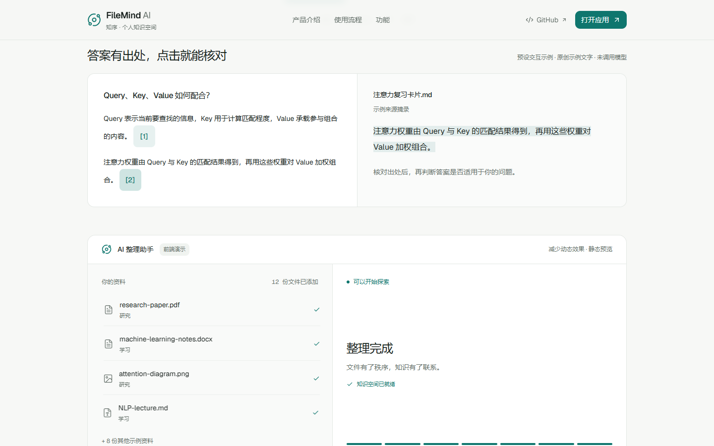
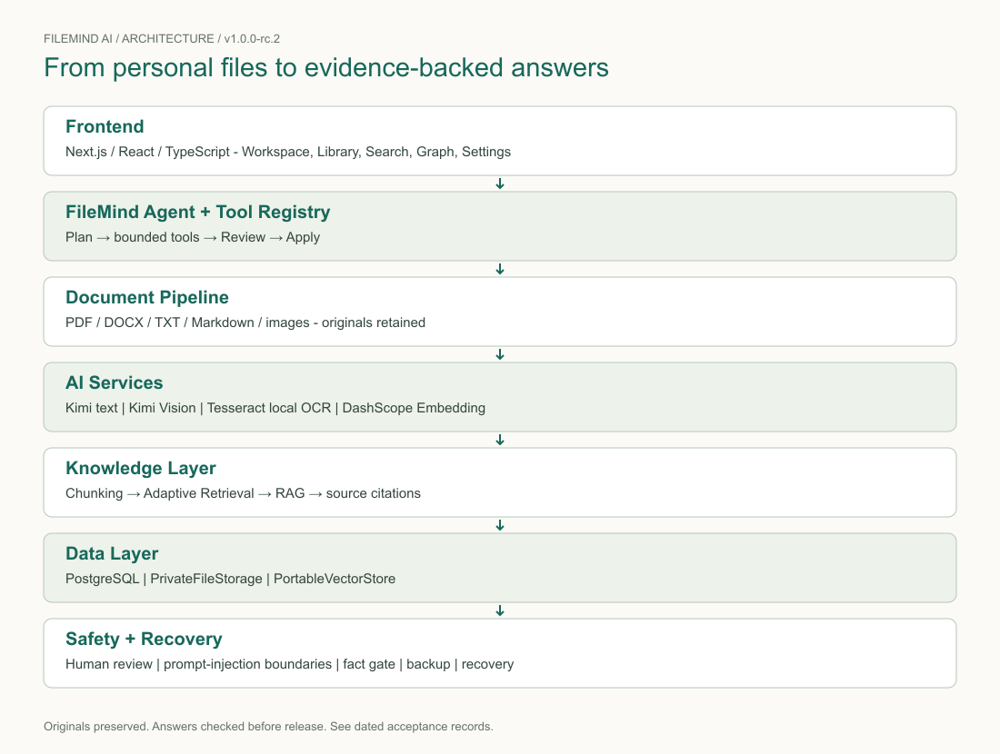
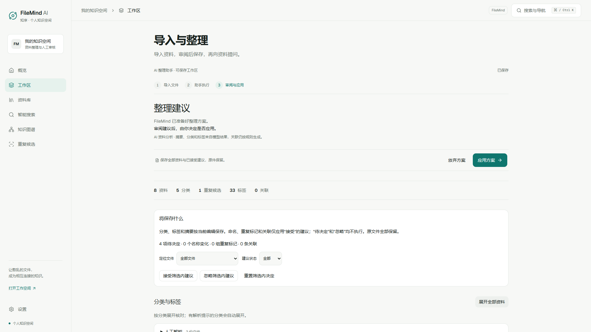
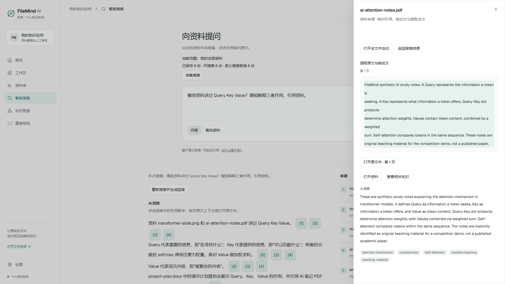

# FileMind AI 技术报告

> 12 页；2026-10-31；1.0.0-rc.2；应用提交 7ed9043d26c79194fdc7c103905e30e9c2d49a42。

## 第 1 页：FileMind AI

*01 / 1.0.0-rc.2 / 7ed9043*

从资料中找到答案，回到原文核对。导入文档和图片，AI 给出整理建议，用户审阅后保存。提问时保留证据入口，点引用即可查看原文或原图。

本报告绑定 1.0.0-rc.2 应用提交 7ed9043，构建日期 2026-10-31。后续文档提交只补充材料与验收记录。实际 ZIP 校验、当天真实服务结果见 release-freeze.md 和 docs/evaluation。

维护者 s0nggv0；队名、学校、成员及实际分工由参赛者补充。最终视频由参赛者配音剪辑，原始 AI 对话链需单独导出核对。

## 第 2 页：问题与展示顺序

*02 / 1.0.0-rc.2 / 7ed9043*

分散的课件、笔记和截图让人难以找到结论出处。回答流畅并不能证明正确，因此产品把引用和原件放在可直接操作的位置。

本轮首页增加明确标注的预设引用示例，让评审在登录或上传前理解核对方式。正式演示第一分钟展示真实答案与原文，预设示例不冒充模型生成。

审阅页主要动作移至顶部并保持可见，资料详情默认收起，保留按项和全部展开。搜索页合并准备入口，当前范围与准备状态保持明确。

## 第 3 页：开发 AI 的意图控制

*03 / 1.0.0-rc.2 / 7ed9043*

本轮用户明确限定：统一提交版本、提前展示引用核对、减少审阅滚动与搜索准备入口。扫描 PDF、账号系统和大规模向量索引不在本轮范围。

上下文由用户需求、仓库 AGENTS.md、相关源码、当前差异、框架本地指南及真实测试失败构成。先定位可改模块，再约束保持人审、保存和来源权限语义不变。

AI 负责提出和实施补丁，开发者通过需求与反馈控制方向。每个可审阅单元单独 Commit 和普通 Push，不改写历史。测试通过是特定行为证据，不代表 AI 生成的所有代码天然可靠。

## 第 4 页：真实演进与 Prompt 证据

*04 / 1.0.0-rc.2 / 7ed9043*

15ab879：前置引用核对并收紧审阅操作。59318c2：rc.2 构建与请求预算。7ed9043：修复中文化误改磁盘目录造成的演示资料下载失败，并让真实预检生成本机 Vision 记录。最终应用冻结于 7ed9043。

第一次浏览器整组检查出现两个失败，原因是模拟非持久环境中的准备回调被条件化。恢复父级回调后，五项定向检查通过。应同时保存首次失败和修复结果，不能只保留最终绿色截图。

比赛要求至少三条完整原始对话链。当前报告和运行时 Prompt 不能代替这些原件。录制时展示用户提问、AI 可见建议、真实 Bug 修复往返和对应 diff；旧聊天导出需参赛者核对，不编造历史。

## 第 5 页：系统架构

*05 / 1.0.0-rc.2 / 7ed9043*

Next.js / React 提供中文界面及服务路由。Agent 通过受限 Tool Registry 生成方案，文档管线提取资料，知识层完成分段、检索与有来源回答。

PostgreSQL 保存工作区和索引，私有文件目录保留原件。Kimi 文本、Kimi Vision、DashScope Embedding 与本地 Tesseract 分工独立；执行受身份、版本、人审及恢复边界约束。

## 第 6 页：架构约束与人审

*06 / 1.0.0-rc.2 / 7ed9043*

整理遵循 Plan → 受限工具 → Review → Apply。模型输出要经过结构校验，工具没有任意命令执行能力。应用只执行用户确认的建议，检查持久化版本与操作锁。

本轮界面压缩不改变确认语义：收起的是详情，应用和放弃仍由用户明确操作。搜索准备统一入口不应改变当前资料范围，也不能因索引未准备而静默丢弃已保存文件。

资料和图片中的文字是被分析的数据，不获得系统指令权限。引用从当前身份的数据读取；跨租户、失效版本和伪造来源应由服务端拒绝。

## 第 7 页：检索、回答与原件

*07 / 1.0.0-rc.2 / 7ed9043*

文档解析后形成 chunks 和向量，按查询特征选择语义、词法增强或文件名路径。PortableVectorStore 仍使用本地扫描检索，尚未宣称大规模容量。

回答先检索和检查证据，再生成结构化草稿。来源校验、claim 支持、数字一致性与冲突披露参与发布判断；未通过检查的草稿不直接呈现为正式答案。

引用抽屉展示上下文、高亮和原文件入口。图片区分 OCR 可见文字与 AI 视觉解释，保留原图。资料不足、歧义、冲突和服务错误分开呈现；用户仍应亲自核对证据。

## 第 8 页：可复现性与版本绑定

*08 / 1.0.0-rc.2 / 7ed9043*

应用身份由 current-release.json、设置页 Build 信息和 ZIP release-manifest.json 共同核对。每个包内文件记录 SHA-256，ZIP 另有独立校验值。文档提交晚于应用源码提交不意味着运行代码改变。

便携包按允许列表包含 Node、PostgreSQL、生产构建、本地 OCR 与合成资料；排除密钥、数据库 data 和用户原件。新环境生成随机凭据和空数据库。

Windows x64 可写 ASCII 路径是验收范围。快速指南规定先取得有效 API Key 和网络条件；下载、申请账号与机器差异不算已证明的十分钟。实际解压启动耗时另有 receipt。

## 第 9 页：新环境的真实检查

*09 / 1.0.0-rc.2 / 7ed9043*

预检检查数据库、存储、模型凭据、文本和向量请求、演示资料、Vision、本地 OCR、磁盘、端口与构建。缺少 Key 的 7/12 是预期未就绪状态，不能当成真实 AI 成功。

便携预检在真实 Vision 成功后生成本机验证记录，失败时清除旧记录。这个修复避免评审复制开发者私有验证文件。

本轮所有收费请求仅使用合成资料，累计最多 60 次，失败和重试也计入。持久 JSONL 在请求发出前记录并加锁；重启不清零，不能删除预算记录绕过上限。

## 第 10 页：评测结果的适用范围

*10 / 1.0.0-rc.2 / 7ed9043*

历史 Phase 8 首轮为 90 份原创合成资料、180 道问题。136 道有相关文档题的检索指标很高，但回答召回为 114/136，误拒答 8/136；冲突正确 2/8、歧义澄清 0/8。失败原记录保留。

169 个有效引用与 378/378 已发布 claims 的自动指标是条件统计，不能抵消未发布或 unavailable。生成与判断共享模型家族，存在相关误差，合成短资料也不能代表所有真实长文。

后续定向修复与当天演示分别证明特定链路，不用于重写原始盲测成绩。最新本地回归为 160 项单元测试；浏览器首次失败与定向修复记录另列。

## 第 11 页：交付材料与视频

*11 / 1.0.0-rc.2 / 7ed9043*

当前材料包含 README、快速复现、技术 PDF、中文截图、架构图、当天检查索引及运行包校验。真实浏览器原片单独交付，不将预设示例或注入响应称为真实模型输出。

视频稿目标 7 分 20 秒，其中 3:00–5:30 留给真实 AI 协同录屏。用户配音剪辑为最终 1080p MP4；字幕为待对齐的口播草稿。

至少三条完整原始 Prompt 链、团队信息和官网提交是参赛者最后核对项。保留历史记录和必要源码，删除可再生的旧运行包；不把失败证据当冗余删除。

## 第 12 页：隐私、限制与后续

*12 / 1.0.0-rc.2 / 7ed9043*

仓库在 2026-10-31 已核验公开。历史扫描覆盖已配置密钥与常见模式，未发现命中；这不能自动识别所有语义私人内容。演示只用合成资料，云服务会接收对应文本或图片。

当前没有完整账号系统、多人协作或大规模向量索引。扫描 PDF 仍需额外处理；OCR 和视觉解释可能错误。备份有完整性校验但不加密，恢复密钥需要用户妥善保存。

后续优先用真实长文与独立人工评价验证质量，比赛前以稳定复现和来源核对为主。提交状态以当天验收索引为准，不因版本号或文档生成成功就宣称全部要求完成。
