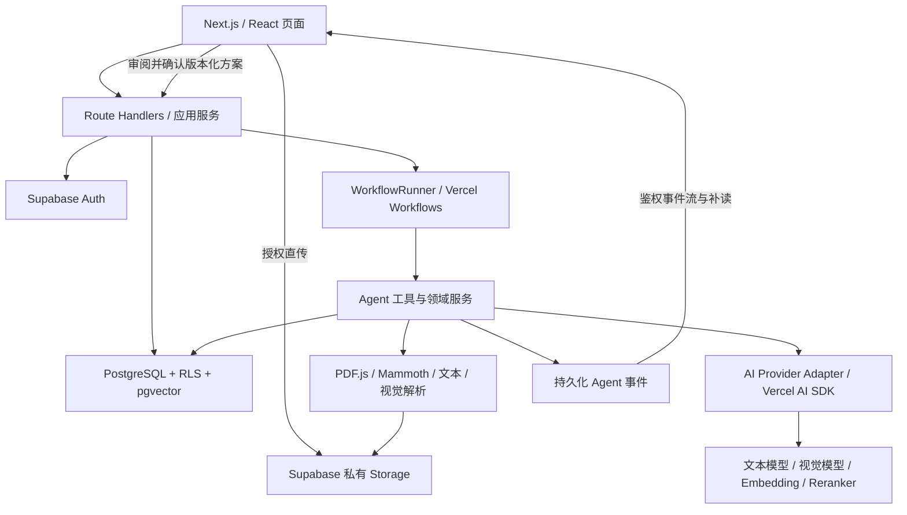
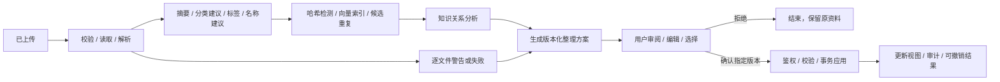

# FileMind AI / 知序 AI：技术架构与分阶段开发设计

日期：2026-10-01  
状态：待用户审阅的设计方案  
当前交付范围：需求分析、架构、目录、数据库、页面、Agent、RAG、阶段规划、风险与 MVP 对照。本文为设计文档，不是已实现能力；当前不创建项目代码、安装依赖或执行部署。

## 1. 需求分析与产品边界

FileMind AI 的核心价值，是把用户上传的散乱资料转成可检索、有出处、能建立关联的个人知识空间。关键产品闭环为：**导入资料 → 看见 Agent 分析 → 审阅整理方案 → 确认执行 → 带引用检索 → 发现关联 → 持续清理**。

### 1.1 必须成立的产品原则

| 原则 | 落地约束 |
|---|---|
| AI 参与任务执行 | Agent 通过有类型的工具读取、分析、检索、生成计划；界面展示真实工具状态与结果 |
| 用户控制整理结果 | 分类、标签、批量命名、归档等变化先进入方案；用户确认后才应用 |
| 原始资料可追溯 | 原文件保持不可变；派生文本、摘要、索引与原始版本关联 |
| 回答有出处 | 先检索，再生成；引用只能来自检索结果，并能打开对应原文位置 |
| 不确定性可见 | 提供解析警告、证据强弱和待复核原因；未校准的模型分数不冒充概率 |
| 工作可恢复 | 页面刷新、连接中断、单个文件失败，不应导致整批任务丢失 |
| 演示与真实能力区分 | fixtures 在独立 demo 层，明确标记“演示数据”；真实上传不返回预写答案 |

### 1.2 建议采用的初始假设

这些是可调整的设计参数，不是比赛规则或已经测得的性能承诺。

- 目标用户先聚焦高校学生与研究者，每位用户一个私有知识空间；不包含团队协作权限系统。
- 中文界面优先，支持中英混合文档与中英文问题。
- 首批支持 PDF、DOCX、TXT、MD、PNG、JPG/JPEG；不将旧版 DOC、压缩包和音视频纳入当前格式承诺。
- 初始可配置上限：每批 50 个文件、单文件 20 MB、批次总量 200 MB；扫描 PDF 初始最多 50 页，超限时明确提示拆分。上线前依据实际套餐和压测调整。
- 不包含桌面磁盘同步、自动修改本地文件、多人共享、联网替用户补充资料、商业计费。
- “移动”首先指知识空间内的逻辑分类调整；“重命名”指显示名称调整，存储对象键与原文件字节不变。
- 知识图谱是 PostgreSQL 关系数据的视图，无需额外引入图数据库。

### 1.3 架构方案比较

| 方案 | 优点 | 代价 | 判断 |
|---|---|---|---|
| 模块化单体 + 持久化工作流 | 一套 TypeScript 项目，复用契约；能在 Vercel 部署并恢复多步任务 | 需要工作流幂等设计，仍要限制单步资源消耗 | **推荐** |
| Next.js + 独立 Node.js Worker + 消息队列 | 重型解析、OCR、长计算更灵活 | 新增服务器运维与跨服务观测 | 大型扫描资料超出 Vercel 单步资源时再扩展 |
| 全部放在一次 API 请求 | 早期容易搭建 | 中断恢复、批量失败与重复执行难以控制 | 仅用于一次性验证，不用于核心整理链路 |

选择推荐方案，同时用 `WorkflowRunner` 接口隔离执行平台，以便将来迁移重型步骤。

## 2. 完整技术架构

### 2.1 系统分层



| 层 | 职责 | 边界 |
|---|---|---|
| `app` | 路由、SSR、页面装配、API 入口 | 不直接实现解析或模型业务 |
| `components` | 基础 UI、导航、状态组件、引用卡片 | 不写死数据，不调用具体模型 |
| `features` | Agent、文档、搜索、图谱、清理交互 | 通过 services 与类型契约通信 |
| `services` | 上传、整理、检索、确认执行等应用用例 | 调用 Repository、解析器和 AI 接口 |
| `lib` | AI、RAG、数据库、Storage、工作流等适配器 | 隔离第三方 SDK 与运行环境 |
| `types` | 文档、计划、工具结果、引用、事件契约 | 共享纯类型，运行时校验与类型同步 |
| `store` / `hooks` | UI 状态、事件订阅、上传队列、快捷键 | 数据库任务状态是最终依据 |

### 2.2 技术栈与状态边界

- 前端保留指定栈：Next.js App Router、React、TypeScript strict、Tailwind CSS、shadcn/ui、Lucide、Framer Motion、Zustand、React Flow。
- Server Components 承担首屏、鉴权后的只读数据与非交互布局；上传、命令面板、Agent 时间线、搜索输入与图谱使用 Client Components。
- Zustand 仅保存选择、面板、上传队列、筛选及事件投影，不持久化完整文件、密钥或数据库的权威状态。
- 分类、排序、搜索范围等可分享状态写入 URL。数据通过应用服务获取；确认执行后失效并刷新相关页面数据。
- 模型调用、解析与工作流步骤使用 Node.js 服务端运行时。浏览器 PDF 阅读器使用独立 PDF.js worker，并延迟加载。
- Zod 或兼容的运行时 Schema 校验 API 输入、工具输入、结构化 AI 输出与事件。
- Phase 1 实际开始时验证框架与插件兼容性，选择稳定版本并锁定依赖；本设计不凭记忆指定“最新版本号”。

### 2.3 AI Provider Adapter

适配层提供以下独立能力：

| 能力 | 输入 / 输出 | 调度规则 |
|---|---|---|
| 文本生成与流式输出 | 提示、检索上下文 → 文本及 usage | 用于解释、回答、摘要 |
| 结构化分析 | 文本 + Schema → 已校验分析结果 | 用于分类、标签、计划 |
| Tool Calling | 消息 + 工具白名单 → 工具调用 | 调用由服务端鉴权和预算控制 |
| 视觉理解 | 私有图像字节或受控访问 → 文字与结构 | 只路由到实际支持视觉的模型 |
| Embedding | 文本批次 → 向量与 profile | 与生成模型配置独立 |
| Rerank | 问题 + 候选片段 → 重排结果 | 可选专用模型，保留降级路径 |

配置区分 `chatModel`、`analysisModel`、`visionModel`、`embeddingProfile`、`rerankModel`。每个模型登记能力、超时、上下文预算、限流与价格配置。OpenAI、Gemini、DeepSeek 分别通过适配器接入，不假设所有提供方都具备视觉、Embedding 或相同的工具能力。

Vercel AI SDK 提供统一模型接口，但具体模型能力仍须验证。业务服务依赖自有能力接口，不直接散落第三方 Provider 实例。[AI SDK Providers and Models](https://ai-sdk.dev/docs/foundations/providers-and-models)

聊天与视觉模型可以独立切换。**Embedding 模型、输出维度、归一化方法变化时必须重建索引**，即使两个模型维度相同，其向量也不能直接混合比较。迁移使用新 profile 和影子索引，通过质量检查后切换；旧索引保留至迁移成功。

### 2.4 持久化任务与实时体验

采用 Vercel Workflows 调度解析、分析、索引、关联与计划步骤。其支持暂停、恢复与失败重试；每个步骤仍需在函数资源限制内完成，不能把一整个重型扫描批次塞进单步。[Vercel Workflows](https://vercel.com/docs/workflows)

- `ai_tasks` 表示用户可理解的任务；`agent_runs` 表示执行尝试；`agent_steps` 表示工具调用；`agent_events` 表示可重放的 UI 事件。
- 调度请求先写任务，标记 `pending_dispatch`。定期 reconciliation 补派未启动任务，并校验已有 workflow/run，避免提交成功但调度失败的双写问题。
- 工作流状态是执行事实，PostgreSQL 保存业务事实与用户可见投影；重启时校对二者，不宣称跨平台全局“恰好执行一次”。
- 生成方案后通过工作流的持久化等待机制等待确认或到期，不占用一条 HTTP 连接。确认先提交数据库批准记录，再发送恢复信号；任务表保存待恢复意图供 reconciliation 补发。恢复信号只是唤醒，执行步骤必须重新读取数据库中的批准记录。
- Agent 事件先持久化再发送；客户端按 `(run_id, sequence)` 去重，以最后序号重连补读。
- 前台采用鉴权 SSE；连接超时后续接，失败时切换有游标的轮询。SSE 结束不会停止后台任务。
- LLM 回答 token 流与 Agent 工具事件分开处理；聊天完成后保存完整回答、引用及 usage。
- 进度来自已完成文件数、页数和步骤数；未确定总量时显示阶段与数量，避免虚假百分比。
- 展示“正在识别主题”“已处理 18/42 个文件”等操作摘要与工具输出，不依赖展示模型内部推理过程。

### 2.5 上传、数据隔离与部署

上传流程：创建上传会话 → 校验用户与配额 → 浏览器授权直传私有 Storage → 完成回调核验对象 → 创建版本及任务。大文件采用 TUS 断点续传。Vercel API 只处理元数据与授权，避开函数请求体的 4.5 MB 限制。[Vercel Functions Limits](https://vercel.com/docs/functions/limitations)、[Supabase Resumable Uploads](https://supabase.com/docs/guides/storage/uploads/resumable-uploads)

- Storage 对象键：`user_id/document_id/version_id/original`，不使用未校验文件名拼路径，不允许上传覆盖原对象。
- 上传完成后由服务端校验对象所属、大小、MIME 与文件签名；未完成会话和孤立临时对象定期清理。
- 私有原文件与预览通过短期签名链接访问；数据库保存 bucket/path，临时 `storage_url` 通过服务计算，不把过期链接当持久标识。
- 数据库使用 Supabase Auth、PostgreSQL、pgvector；页面、API、工作流部署 Vercel，同区域优先。
- 公共网站和 demo 资料可公开；用户原文件、正文、向量、聊天、计划和事件必须隔离。
- 用户请求以用户会话执行；后台专用凭据只在服务端使用，并显式绑定任务所有者。
- secrets 与旧式 `service_role` 凭据可绕过 RLS，不能进入浏览器；数据库视图和 RPC 也必须验证安全上下文。[Supabase Row Level Security](https://supabase.com/docs/guides/database/postgres/row-level-security)

## 3. 项目目录设计

以下目录树是后续代码位置规划，当前仅保存本设计文件。

```text
src/
  app/
    (marketing)/page.tsx                   # /
    (auth)/login/page.tsx                  # 真实模式所需的辅助登录
    (product)/layout.tsx                   # 私有空间导航与鉴权
    (product)/dashboard/page.tsx
    (product)/workspace/page.tsx
    (product)/library/page.tsx
    (product)/library/[id]/page.tsx
    (product)/search/page.tsx
    (product)/graph/page.tsx
    (product)/cleanup/page.tsx
    api/
      uploads/init/route.ts
      uploads/complete/route.ts
      documents/[id]/route.ts
      agent/runs/route.ts
      agent/runs/[id]/route.ts
      agent/runs/[id]/events/route.ts
      agent/runs/[id]/cancel/route.ts
      organization-plans/[id]/route.ts
      organization-plans/[id]/confirm/route.ts
      search/route.ts
      chat/route.ts
      graph/route.ts
      cleanup/issues/route.ts
      cleanup/issues/[id]/resolve/route.ts
    layout.tsx
    globals.css
    loading.tsx
    error.tsx
    not-found.tsx
  components/
    ui/                                   # shadcn 与通用基础组件
    shell/                                # Sidebar / Header / MobileNav
    feedback/                             # Loading / Empty / Error / Toast
    command-palette/
    citation/
  features/
    agent/                                # 时间线、阶段、方案审阅
    documents/                            # 上传、Library、预览、详情
    search/                               # Query、结果、追问
    graph/                                # 节点、边、右侧关系解释
    cleanup/                              # 问题组、差异、接受/忽略
    dashboard/                            # 真实计数与洞察
  hooks/                                  # useAgentEvents / useUploadQueue
  store/                                  # UI 投影，不存服务端密钥
  types/                                  # document / agent / plan / citation
  services/                               # 用例服务与 API client
  lib/
    ai/                                   # capabilities / providers / schemas
    rag/                                  # chunk / embed / retrieve / rerank
    database/                             # clients / repositories / RPC 契约
    storage/                              # 上传、签名与对象校验
    parsers/                              # pdf / docx / text / image
    agent/                                # 工具注册、预算、策略、状态机
    workflow/                             # WorkflowRunner 适配器
    security/                             # auth / policy / safe-render
    observability/                        # request_id / usage / metrics
  workflows/                              # 整理、索引、应用计划
  mocks/                                  # 独立 fixtures 和 demo repository
supabase/
  migrations/                             # 后续 SQL Schema 与 RLS
  tests/                                  # 权限及约束测试
tests/
  unit/                                   # 关键解析、切块、策略逻辑
  integration/                            # RAG、工具、计划执行
  e2e/                                    # 真实闭环与响应式
  fixtures/                               # 可授权测试文档
  evals/                                  # 检索与引用评测题集
docs/
  superpowers/specs/                       # 当前架构文档
  phase-checklists/
public/
  brand/
  demo/
```

组件通常控制在 300 行以内；超过 400 行时审查职责并拆分。页面不把工具、模型、数据库、动画与表单处理堆在一个文件里。共享逻辑抽取以真实复用为依据，不提前构建庞大的抽象框架。

## 4. 数据库 Schema 设计

### 4.1 通用约定

- 主键 UUID，时间为 `timestamptz`，文件大小 `bigint`，状态使用受约束枚举，结构化载荷 `jsonb` 并在应用层校验。
- 私有业务表均带 `user_id`；主实体建立 `(user_id, id)` 唯一键。子表用复合外键确保引用对象同属一位用户。
- 下列字段未标注 `?` 均为必填；`created_at` 默认当前时间；有 `updated_at` 的表统一维护更新时间。
- `auth.users` 管理认证身份；`public.users` 只保存应用资料，不复制密码或认证凭据。
- 文档原始版本、派生内容、向量 profile 与整理方案版本分别记录，避免内容更新后旧引用和旧方案误用。

### 4.2 用户、文件与内容索引

| 表 | 核心字段与类型 | 关键约束 / 用途 |
|---|---|---|
| `users` | `id uuid`、`display_name text`、`avatar_url text?`、`preferences jsonb`、`created_at`、`updated_at` | `id → auth.users.id`；单用户私有空间 |
| `documents` | `id uuid`、`user_id uuid`、`name text`、`original_name text`、`file_type text`、`file_size bigint`、`storage_bucket text`、`storage_path text`、`current_version_id uuid?`、`summary text?`、`category_id uuid?`、`status enum`、`organization_status enum`、`revision int`、`archived_at timestamp?`、`created_at`、`updated_at` | `name` 是显示名；`status=uploading/processing/ready/needs_review/failed`；整理状态 `unorganized/organized`；原始名称不可覆盖；签名 `storage_url` 由服务生成 |
| `document_versions` | `id uuid`、`user_id uuid`、`document_id uuid`、`version_no int`、`storage_bucket text`、`storage_path text`、`file_size bigint`、`byte_hash text`、`normalized_content_hash text?`、`parsed_content_path text?`、`parser_version text?`、`parse_status enum`、`warnings jsonb`、`page_count int?`、`created_at` | `(document_id, version_no)` 唯一；字节哈希用于完全重复；归一化正文另存哈希，不混淆二者 |
| `embedding_profiles` | `id uuid`、`provider text`、`model text`、`dimensions int`、`distance_metric text`、`normalization text`、`chunker_version text`、`index_version int`、`status enum`、`created_at` | 全局配置表，仅服务端写；每个 profile 固定向量语义、维度和距离计算方式 |
| `document_chunks` | `id uuid`、`user_id uuid`、`document_id uuid`、`version_id uuid`、`file_name text`、`page int?`、`page_label text?`、`chunk_index int`、`content text`、`embedding vector(1536)?`、`embedding_profile_id uuid`、`metadata jsonb`、`token_count int`、`content_hash text`、`index_status enum`、`created_at` | `(version_id, embedding_profile_id, chunk_index)` 唯一；只检索当前版本、active profile 与 `ready` chunks；`file_name` 保留索引时快照，UI 展示当前名字 |

`metadata` 至少记录：`source_type`、`section_path`、`paragraph_start/end` 或 `line_start/end`、`char_start/end`、`page_end?`、`bbox?`、`extraction_method`、`extraction_confidence?`、`parser_version`。PDF `page` 是从 1 开始的物理页，`page_label` 是印刷页码，二者分开。DOCX/MD/TXT 默认 `page=null`，使用章节、段落或行号；图片使用图像区域或整体来源。

初始 profile 选择已验证支持的 1536 维文本 Embedding，配置与模型独立记录。pgvector 常规 `vector` 的 HNSW 索引维度上限为 2000，`halfvec` 为 4000；若后续选择 3072 维，应显式改为合适的影子表/索引设计，不能直接往 `vector(1536)` 写入。[Supabase Vector Indexes](https://supabase.com/docs/guides/ai/vector-indexes)

新维度迁移创建物理隔离的 chunk 索引表或分区，再由 Repository 路由；相同维度的新 profile 也必须完整重嵌入。迁移期间只有一个 active profile 用于查询。向量字段在排队时可空，`ready` 时必须非空，且向量长度与 profile 一致。

### 4.3 分类、标签、关联与概念

| 表 | 核心字段与类型 | 关键约束 / 用途 |
|---|---|---|
| `categories` | `id uuid`、`user_id uuid`、`parent_id uuid?`、`name text`、`slug text`、`sort_order int`、`created_at`、`updated_at` | 支持“课程 / 数学 / 线性代数”；同用户同父节点名称唯一，根节点也唯一；服务端检测循环 |
| `tags` | `id uuid`、`user_id uuid`、`name text`、`normalized_name text`、`created_at` | `(user_id, normalized_name)` 唯一 |
| `document_tags` | `user_id uuid`、`document_id uuid`、`tag_id uuid`、`source enum`、`confidence real?`、`created_at` | `(document_id, tag_id)` 主键；`source=user/ai_confirmed` |
| `document_relations` | `id uuid`、`user_id uuid`、`source_document_id uuid`、`target_document_id uuid`、`relation_type enum`、`similarity real?`、`confidence real?`、`reason text`、`evidence jsonb`、`status enum`、`created_at` | 禁止自关联；关系类型如主题关联/内容重叠/版本候选；有向和无向关系分开去重 |
| `concepts` | `id uuid`、`user_id uuid`、`name text`、`normalized_name text`、`aliases jsonb`、`kind enum`、`description text?`、`created_at` | 同用户概念唯一，`kind=topic/concept`；别名合并需证据 |
| `document_concepts` | `user_id uuid`、`document_id uuid`、`version_id uuid`、`concept_id uuid`、`evidence jsonb`、`confidence real?`、`created_at` | 唯一 `(version_id, concept_id)`；证据指向真实 chunk/位置 |
| `concept_relations` | `id uuid`、`user_id uuid`、`source_concept_id uuid`、`target_concept_id uuid`、`relation_type text`、`reason text`、`evidence jsonb`、`confidence real?`、`created_at` | 如 Self-Attention 属于 Attention；无证据时只表达共同出现，不声称推导关系 |

MVP 图谱由 `documents + document_relations` 投影生成。比赛完整版启用概念三表，支持文件、主题、概念三类节点。图节点布局坐标属于用户视图偏好，不作为知识事实。

### 4.4 Agent、整理方案、清理与审计

| 表 | 核心字段与类型 | 关键约束 / 用途 |
|---|---|---|
| `ai_tasks` | `id uuid`、`user_id uuid`、`task_type enum`、`status enum`、`document_ids uuid[]`、`goal text`、`progress jsonb`、`dispatch_status enum`、`workflow_id text?`、`idempotency_key text`、`error_code text?`、`created_at`、`updated_at` | `(user_id, idempotency_key)` 唯一；用作持久化派发意图与任务状态 |
| `agent_runs` | `id uuid`、`user_id uuid`、`task_id uuid`、`workflow_id text?`、`goal text`、`status enum`、`display_phase enum`、`model_config jsonb`、`budget jsonb`、`usage jsonb`、`started_at timestamp?`、`completed_at timestamp?`、`created_at` | 预算包括最大步骤、tokens、重试和时长；一个 task 可有多次恢复/重试 run |
| `agent_steps` | `id uuid`、`user_id uuid`、`run_id uuid`、`sequence int`、`tool_name text`、`status enum`、`input jsonb`、`output jsonb?`、`output_ref text?`、`attempt_count int`、`idempotency_key text`、`error_code text?`、`started_at timestamp?`、`completed_at timestamp?`、`created_at` | `(run_id, sequence)` 唯一；幂等键唯一；大正文用引用，事件不广播原文全量 |
| `agent_events` | `id uuid`、`user_id uuid`、`run_id uuid`、`step_id uuid?`、`sequence bigint`、`event_type text`、`payload jsonb`、`created_at` | `(run_id, sequence)` 唯一；用于补读，不长期保存 token 级噪声 |
| `organization_plans` | `id uuid`、`plan_group_id uuid`、`user_id uuid`、`run_id uuid`、`revision int`、`status enum`、`summary jsonb`、`plan_hash text`、`expires_at timestamp`、`approved_by uuid?`、`approved_at timestamp?`、`approved_action_ids uuid[]`、`created_at`、`updated_at` | `(plan_group_id, revision)` 唯一；每个 revision 新建一行快照；`draft/pending_review/approved/applying/applied/rejected/expired/superseded/failed`；旧批准失效 |
| `organization_actions` | `id uuid`、`user_id uuid`、`plan_id uuid`、`plan_revision int`、`document_id uuid`、`action_type enum`、`expected_document_revision int`、`before jsonb`、`after jsonb`、`reason text`、`confidence real?`、`selected boolean`、`status enum`、`idempotency_key text`、`created_at` | `classify/rename_display/add_tags/archive/restore`；不允许任意字段写入；保留可复核差异 |
| `cleanup_issues` | `id uuid`、`user_id uuid`、`issue_type enum`、`document_ids uuid[]`、`source_revisions jsonb`、`evidence jsonb`、`recommendation jsonb`、`status enum`、`organization_plan_id uuid?`、`created_at`、`updated_at` | `open/accepted/ignored/resolved/stale`；忽略绑定内容版本，新版本可重新发现 |
| `audit_events` | `id uuid`、`user_id uuid`、`actor_type enum`、`actor_id uuid?`、`operation text`、`entity_type text`、`entity_id uuid`、`plan_id uuid?`、`before jsonb?`、`after jsonb?`、`request_id text`、`created_at` | 追加写入，普通客户端不能修改；不把 secrets 或全量文件正文写入审计 |

`document_ids` 数组在插入时逐项核验归属；实际执行仍从文档实体重新取数。需要数据库级成员约束时，在实现阶段以任务/问题成员表替代数组，不信任客户端提交的归属信息。

### 4.5 会话与引用

| 表 | 核心字段与类型 | 关键约束 / 用途 |
|---|---|---|
| `chat_sessions` | `id uuid`、`user_id uuid`、`title text`、`scope jsonb`、`created_at`、`updated_at` | scope 保存用户选择的文档/分类范围 |
| `chat_messages` | `id uuid`、`user_id uuid`、`session_id uuid`、`role enum`、`content text`、`status enum`、`citations jsonb`、`retrieval_metadata jsonb`、`model text?`、`usage jsonb`、`created_at` | 引用保存 `chunk_id/version_id/document_id/locator/quote`；引用内容必须经服务端验证；未完成流标记 interrupted |

引用使用已取回 chunk 的稳定 ID，而不是模型自由生成文件名或页码。文档更新后旧消息仍指向旧版本；归档资料默认不参与新检索，但用户经授权仍能查看历史引用。永久删除后引用显示“来源已删除”，不能自动替换为另一个版本。

### 4.6 索引、约束与权限

- `documents.current_version_id` 用 `(user_id, id, current_version_id)` 外键引用 `document_versions(user_id, document_id, id)`，确保当前版本确实属于该文档；上传初始化时允许为空。chunk 对 document/version 也使用同一归属约束。
- `organization_actions` 通过 `(user_id, plan_id, plan_revision)` 引用精确方案快照；批准动作必须是该快照成员。`approved_by` 必须等于方案所属用户。revision、操作清单与 before/after 不就地覆盖。
- 文档：`(user_id, created_at desc)`、`(user_id, category_id, archived_at)`、`(user_id, organization_status)`。
- 内容：`(user_id, version_id, index_status)`；初始小库可精确向量检索，规模增加时启用 HNSW cosine 索引；检索必须同时过滤所有者、版本、active profile 与归档状态。
- 中文词法补充先用 `pg_trgm` 与规范化术语匹配；英文可用 FTS。PostgreSQL 默认分词不能被当作中文全文检索已解决，需要中文测试集决定后续分词方案。
- Agent：`(user_id, created_at desc)`、`(run_id, sequence)`、未派发任务部分索引、方案状态索引、清理问题类型索引。
- `confidence`、`similarity` 若存在须满足 0–1；它们含义独立。自评置信度显示“模型估计”；相似度不能直接叫“正确概率”。
- 所有用户表与 Storage 启用 RLS；普通客户端不能直接写 `approved_at`、执行状态或审计数据。计划确认与执行走受控服务端用例。
- RPC 默认 `security invoker`；必要的高权限函数限定角色、固定 search path、显式核验所有者。视图使用安全调用上下文或限制暴露。
- Auth 删除触发数据生命周期流程，先移除 Storage 对象再删除业务记录；数据库级级联不等于对象存储已清理。

### 4.7 状态取值与失败恢复

| 对象 | 状态取值 |
|---|---|
| 原文件解析 | `pending/running/ready/needs_review/failed` |
| chunk 索引 | `pending/embedding/ready/failed` |
| embedding profile | `building/active/retired/failed` |
| 用户任务 | `queued/running/awaiting_confirmation/applying/completed/partial_success/failed/cancelled` |
| 工作流派发/信号 | `pending_dispatch/dispatched/pending_resume/resumed/failed` |
| Agent run | `queued/running/awaiting_confirmation/applying/completed/partial_success/failed/cancelled` |
| 工具步骤 | `pending/running/succeeded/failed/skipped/cancelled` |
| 关系分析 | `suggested/confirmed/rejected/stale`；系统展示 suggested 时明确其为 AI 关系建议 |
| 计划动作 | `proposed/skipped/applied/failed/reverted` |
| 聊天消息 | `pending/streaming/completed/interrupted/failed` |

重复工具调用复用已成功步骤结果；外部可重试错误进入退避，预算耗尽后保留失败记录供显式重试。解析、索引、分析和整理分别记录状态，避免“上传成功”被误认为“已进入知识库”。`display_phase` 限定为 `Thinking/Analyzing/Searching/Planning/Executing/Completed`。

## 5. 页面信息架构与 UI Design System

### 5.1 页面结构

| 路由 | 首要用户问题 | 信息与操作 | 关键状态 |
|---|---|---|---|
| `/` | 这能怎样整理我的资料？ | 核心主张、真实产品过程预览、“开始整理”“体验 Demo”、五项能力、数据控制说明 | CTA 加载、未配置真实模式、演示标记 |
| `/dashboard` | 我的知识空间现在怎样？ | 总文件、分类、重复组/涉及文件、待整理计数；最近导入、最近任务、空间主题与有证据的洞察 | 新用户空状态、任务进行中、单项失败 |
| `/workspace` | AI 正在做什么，接下来由我决定什么？ | 拖拽/选择文件、目标输入、逐文件上传；Agent 时间线、阶段与工具结果；结果摘要、方案审阅、确认执行 | idle/uploading/analyzing/partial_success/pending_review/applying/completed/failed |
| `/library` | 怎样找到并浏览已有资料？ | 卡片/列表、分类、标签、类型、时间与状态筛选；排序；归档视图；批量选择 | skeleton/empty/error/ready；URL 保存筛选 |
| `/library/[id]` | 这份资料是什么，依据在哪？ | 原文件预览、AI 摘要、关键概念、标签、相关资料、来源片段与局部图谱 | 解析失败、预览不支持、签名链接失效、来源版本变化 |
| `/search` | 哪些资料能回答我的问题？ | 中央自然语言输入；检索阶段、答案、引用、文件匹配理由；范围选择与继续追问 | 检索中、流式回答、无结果、证据不足、取消、失败重试 |
| `/graph` | 资料之间有什么可解释的联系？ | 文件/主题/概念图谱、搜索、缩放、拖动；选中节点后右侧摘要、关系证据、文件入口 | 无关联空状态、子图加载、筛选无结果 |
| `/cleanup` | 哪些资料需要我处理？ | 重复/相似/命名/未分类/过期候选/孤立分组；证据与差异；接受、忽略、查看差异 | 重新分析、建议过期、待确认、执行成功 |

登录是辅助流程，真实知识空间必须鉴权；demo 为独立只读样例空间，可体验明确标记的模拟整理流程，不能操作真实用户资料。

Dashboard 的“重复”分别显示组数与涉及文件数；“增长 34%”必须说明统计周期、基准和实际数据；没有数据时展示具体可行动的空状态。用户需求中的 42 个文件等数字只进入可识别的 demo fixtures。

### 5.2 视觉方向与设计令牌

采用克制的个人知识工作台：暖白阅读面、石墨色文字、少量青绿色作为当前任务与确认动作强调。暗色模式对应深石墨面，维持同一信息层级；Landing 以真实文件转成知识关系的交互过程为主视觉，避免堆叠装饰特效。

| 令牌 | 初始设计 |
|---|---|
| 亮色 | 背景 `#F7F8F6`、表面 `#FFFFFF`、文字 `#18201D`、次级 `#66716B`、边线 `#E3E8E4` |
| 主强调色 | `#0F766E`；小面积使用，hover/disabled/focus 配套定义 |
| 暗色 | 背景 `#151A18`、表面 `#1D2420`、文字 `#ECF2EE`、次级 `#A5B3AA`、边线 `#334038` |
| 字体 | 中文 Noto Sans SC / 本地可用中文 sans；英文 Geist；工具名使用 Geist Mono。选定后检查授权并自托管子集 |
| 字号 | 产品正文 16px，元信息 13–14px，页标题 28–36px；Landing 主张 48–72px，随视口缩放 |
| 间距与宽度 | 4px 基础尺度；主要节奏 8/16/24/32/48/64；导航约 224px，内容最大宽度约 1280px |
| 表面与运动 | 控制圆角层级，边框只用于分组；150–220ms 状态过渡，复杂图谱动画可关闭 |

所有颜色需在 Phase 1 做对比度检查，状态不只靠颜色区分。Lucide 用于功能识别，不给每一条摘要加装饰图标。

### 5.3 核心交互

- `Cmd/Ctrl+K` 打开 Command Palette；支持页面导航、搜索、上传和最近资料，焦点可返回原位置。
- 上传区域支持键盘与文件选择按钮；拖入时显示文件类型与数量，上传失败可逐文件重试。
- Workspace 用“文件队列 + Agent 时间线 + 方案面板”展示任务；待确认时固定显示变更数量、失败项和用户选择。
- 文件详情默认阅读优先，辅助 AI 信息在侧栏；引用点击定位真实页、段落、行或图片区域。
- 搜索页面展示“检索资料 → 筛选证据 → 生成回答”；引用可在回答未完全结束时出现，但不能先填虚假出处。
- Graph 显示当前节点邻域，hover 轻提示、选中高亮关联；不一次渲染数千节点。初始默认展示不超过约 80 个可理解节点。
- Cleanup 的“接受建议”打开具体 before/after 并确认，原文版本差异采用确定性文本 diff；AI 负责概括已有 diff。

### 5.4 响应式与四种状态

- 1440/1280：稳定的导航与双栏工作台，主操作无需在第一屏外寻找。
- 768–1024：折叠侧栏，工具结果/详情在抽屉打开。
- 360–767：单栏，上传按钮与任务阶段置顶；方案分项审阅；图谱默认切换关系列表，可手动打开精简图谱。
- 所有核心页面具备 loading/error/empty/success；长任务另有 queued、partial success、cancelled、pending review 状态。
- 遵守 `prefers-reduced-motion`，状态变化可由屏幕阅读器感知，交互目标至少 44px，弹层具备键盘焦点管理。

## 6. FileMind Agent 工作流

### 6.1 编排与状态机

**确定的解析与索引流水线 + 有预算的模型规划 + 受控工具执行**。文件读取、权限、持久化与执行边界由代码控制，模型决定语义分析和可选检索路径；不让模型在无限循环中任意调用系统工具。



运行状态：`queued → running → awaiting_confirmation → applying → completed`，并允许 `partial_success/failed/cancelled`。UI 的 Thinking、Analyzing、Searching、Planning、Executing、Completed 是状态投影，不是随定时器播放的假进度。

文件解析失败可以从后续阶段排除并列入结果清单；只有成功解析文件进入摘要和索引。整批均失败时不能生成“整理成功”的结果。取消在步骤边界生效，已完成派生结果保留，不悄悄回滚用户已经确认的行为。

### 6.2 工具契约

所有工具携带可信的 `userId/runId/requestId` 上下文；模型只传允许的业务输入。返回统一包含 `status`、`data/ref`、`warnings`、`evidence`、`usage` 与 `retryable`。

| 工具 | 输入 | 输出 | 权限与边界 |
|---|---|---|---|
| `read_document()` | document/version ID | 标准化内容引用、定位、解析警告 | 只读自己已上传资料，禁止任意路径/URL |
| `summarize_document()` | 内容引用、目标长度 | 摘要、关键概念、证据 | 不以文件名猜正文；长文分层摘要 |
| `classify_document()` | 内容引用、允许分类 | 分类建议、理由、待复核原因 | 不直接更新分类 |
| `generate_tags()` | 内容引用、现有标签 | 规范化标签建议、证据 | 复用标签，控制数量与粒度 |
| `generate_filename()` | 摘要、类型、命名规则 | 建议显示名与理由 | 保留扩展名，拒绝非法字符，不覆盖原对象 |
| `detect_duplicates()` | 版本 ID 集合 | 完全重复/相似/版本候选组与差异 | 哈希与语义相似分开，绝不自动删除 |
| `semantic_search()` | query、范围、topK | 候选 chunk、来源、分数 | 过滤用户、版本、profile、归档 |
| `build_relationships()` | 文档集合、候选邻域 | 有依据的关系建议 | 只比较候选邻居，避免全量两两 LLM 比较 |
| `search_knowledge_base()` | 问题、会话与资料范围 | 重排证据集合、完整引用定位 | 复用 semantic_search 检索流水线，不重复建设 |
| `generate_organization_plan()` | 分析结果、用户目标、现有 revision | 分类/命名/标签/归档操作方案 | schema 校验、冲突检测、无直接执行 |

批准后执行由服务端的 `applyOrganizationPlan` 用例负责，不作为模型随意可调用的危险工具。后续若需要 Agent 工具形式，也必须输入已鉴权的 approval 记录，并重新验证计划版本与文档 revision。

### 6.3 预算、幂等与事件

- 起始参数：文件级 AI 并发 3、模型规划最多 12 步、可重试外部错误最多 3 次；429/5xx 指数退避，权限/格式/schema 错误明确分类。
- 正文解析幂等键由版本、解析器版本组成；嵌入幂等键由 chunk hash 和 embedding profile 组成；计划执行由 plan revision 与 action ID 组成。
- 缓存按用户权限范围复用，禁止跨用户把存在某份私有文件的信息泄露出去。
- 事件类型：`run.started`、`step.started`、`step.progress`、`step.completed`、`step.failed`、`plan.ready`、`run.awaiting_confirmation`、`plan.applied`、`run.completed`。
- 事件载荷包含阶段、工具、文件计数、简短结果和警告；原始 prompt、秘钥和文件全量正文不进入前端事件。
- UI 支持暂停观看、展开工具结果、失败步骤重试与从上次 sequence 恢复。

### 6.4 Human-in-the-loop 的真实执行约束

1. 服务端生成 plan revision，保存不可变 before/after、文档 expected revision、有效期与 plan hash。
2. 用户可取消部分动作或修改建议；修改后生成新 revision，展示更新后的变化。
3. 确认请求绑定用户、plan ID、revision、hash 与所选 action IDs；服务器核验归属、状态、有效期与当前文档 revision，批准记录保存具体 action IDs。修改动作内容需先生成新快照，不能在确认请求中夹带新 after 值。
4. 校验失败返回 conflict 并提示重新审阅；不能将旧确认自动套到新建议。
5. 批次 metadata 操作先锁定所有相关记录，再在事务内应用所选变化、写审计与 applied 状态。刷新、重复点击与步骤重放不会重复执行。
6. Storage 不随逻辑重命名/分类迁移；原始字节不动。需要外部对象变更时使用逐动作状态与补偿，不能宣称数据库事务能覆盖 Storage。
7. 提供反向计划撤销；撤销前仍校验 revision，已被后续操作修改的记录需要再次审阅。

安全能力按功能首次落地时实现；Phase 11 是集中加固与验证，不是到那时才补确认机制。永久删除和覆盖不进入 MVP；比赛完整版若增加这些能力，需要独立明确确认和生命周期任务，Agent 不自动触发。

## 7. RAG 数据流与多模态解析设计

### 7.1 建库链路


| 格式 | 解析方式 | 引用定位与限制 |
|---|---|---|
| PDF 文本型 | PDF.js 逐页抽取，保留文本坐标与阅读顺序 | 物理页码 + 可选印刷页码；双栏、公式、表格需解析警告 |
| PDF 扫描型 | 空文本检测 → 逐页渲染 → 视觉/OCR | 必须保留扫描页与原文区域；公式识别不保证无误 |
| DOCX | Mammoth 提取正文/语义结构，规范化标题与表格 | 章节 + 段落；不假装还原 Word 的分页 |
| TXT / MD | 处理编码、标题、段落、代码块 | 行号/章节；正文与展示 HTML 分离 |
| PNG / JPG | 视觉分析输出文字、主题、知识点、类型与警告 | 图片原件 + 可核验区域；无 bbox 能力时不生成假的文字框 |

PDF.js 提供逐页 `getTextContent`，因此解析器需要独立处理版面和定位；空文本扫描页进入另一条解析路径。[PDF.js PDFPageProxy](https://mozilla.github.io/pdf.js/api/draft/module-pdfjsLib-PDFPageProxy.html)

Mammoth 的转换结果不自带安全清洗，DOCX HTML 预览必须净化并限制外部资源；解析 worker 有大小、解压、时长上限，不能直接信任用户文档。[Mammoth 官方说明](https://github.com/mwilliamson/mammoth.js)

切块起始目标 500–800 tokens，重叠约 80–120 tokens；这是待评测调参范围。优先保留章节与段落边界，PDF 默认不跨页；表格、代码块与定义尽量完整，超长块显式拆分。中文用所选模型兼容计数器校验，不能拿字符数当 token 数。

索引按版本构建；新版本建库成功后事务切换 current version，旧版本继续支撑旧消息引用。索引前校验 chunk 数量、正文非空、向量维度与定位有效性，失败不能标记 ready。

摘要、标签和分类建议可在确认前保存为派生分析，但用户分类、标签关系、显示名与归档状态必须待确认。已完成索引的未整理资料可在“全部资料”中检索，显示待整理状态；检索过滤采用当前数据库分类，不信任 chunk 中过期分类快照。

### 7.2 查询链路


初始候选约 30 个，重排后保留 6–10 个片段；限制单文档占比，合并邻近 chunks，按 context token 预算裁剪。这些数量依据评测调整。向量检索是核心，术语匹配补充 Q/K/V、公式名称和文件类型等精确信息。[Supabase Hybrid Search](https://supabase.com/docs/guides/ai/hybrid-search)

专用 Reranker 为可替换能力。MVP 没有专用服务时采用向量与词法融合、文档多样性、邻块合并的确定性排序，界面不标记为已经使用专用重排模型；比赛完整版接入重排并通过同一测试集验证改进。

### 7.3 引用、追问与无证据处理

- 上下文片段分配 `[S1]` 等稳定引用 ID，附 document/version/chunk 与真实 locator。
- 模型只引用这些 ID；服务端检查引用属于本次检索、属于当前用户且 quote 可在 chunk 中定位。
- 显示文件名、PDF 物理页或章节/行号、相关原文片段；点击打开对应版本与位置。
- 引用合法不等于断言必然被支持；引用正确性与答案依据需要独立评测，重点验证可核查事实。
- 追问先结合会话改写为独立问题，再重新检索；“与哪些资料有关”通过关系邻域和检索结果回答。
- 未找到足够资料时明确说明“当前知识库没有足够证据”，提示缩小范围或导入资料；不能用模型常识伪装成本地文件内容。
- 用户主动要求通用解释时才单独标注“模型补充解释”，不为补充内容附虚假本地引用。
- “匹配度 96%”只有在标明计算方法的评分体系下使用；默认显示“高相关 / 一般相关”及匹配理由，余弦相似度不作为答案正确概率。

### 7.4 重复检测、关系构建和图片

完全重复用原始字节 SHA-256；内容重复用标准化正文 hash；高度相似资料用文档/片段向量召回，再比较内容重叠与确定性 diff。版本候选展示增删段落、字数与结构变化。相似阈值必须用人工标注的重复/不同版本/同主题样本评测，不能统一硬写 0.96 并当作可信结论。

知识关系先用 Embedding 与概念重合召回邻居，模型只解释少量候选，并引用证据。默认有证据的主题关联与内容重叠；“由此推导”“引用了”必须存在明确文本证据。避免全库 O(n²) 次模型调用。

图像进入统一 ParsedDocument 契约：`image_type/topic/ocr_text/knowledge_points/tags/warnings/locator`。OCR 文字与视觉推断描述分开存储；可检索内容包括 OCR 与明确标注的结构化描述。没有视觉能力时显示不可解析和配置提示，不偷偷换成文件名摘要。

### 7.5 RAG 验收建议

建议建立 30–50 个中英混合、页码明确的问答样本，覆盖同义表达、Q/K/V、跨文档比较、图片、无答案、恶意文档指令与过期版本。

| 指标 | 初始验收目标 |
|---|---|
| 来源引用有效率 | 测试集中无不存在文件、伪造页码和跨用户引用 |
| Recall@10 | 核心评测集目标 ≥ 85%，先测基线再调参 |
| 答案证据支持率 | 人工检查目标 ≥ 90%，记录失败类型 |
| 空知识库/无答案 | 清楚拒绝编造，并提供可行动提示 |
| 搜索改写对比 | 同义表达能检索到关键词不同的资料，证明语义检索实际生效 |
| 时延 | 记录 p50/p95 的检索与首 token 时间；根据实际网络与 Provider 制定目标 |

这些是规划目标，当前没有运行实现、测试或达到上述指标。

## 8. 分阶段开发与验收规划

保留用户要求的 12 个 Phase 顺序，提前设计契约与安全边界，按阶段逐个实施。每次 Phase 结束停止供用户验收，不跨阶段一次生成整项目。

| Phase | 实施范围 | 完成标准 / 依赖 |
|---|---|---|
| 1 架构与 Design System | 初始化指定栈；tokens、基础组件、导航壳、类型契约、Repository/Provider 接口、独立 demo 层、环境校验；定义 schema/RLS migration 的落地顺序 | strict 类型、构建与 lint 通过；基础状态、键盘与响应式可验；不声称真实 AI 已接通 |
| 2 Landing + Dashboard | 产品主张与过程预览；可复用概览组件、计数、最近文件/任务与洞察；此时可从明确标记 demo repository 获取 | 两个 CTA 可导航；无真实数据时空状态；统计口径明确 |
| 3 AI Workspace | 文件队列、格式/大小校验、上传生命周期、事件契约、时间线与方案审阅交互；任务 adapter 可先 demo | 全部状态与逐文件失败可验；demo 进度明示；确认不会执行未实现能力 |
| 4 Library | 卡片/列表、URL 筛选排序、文件详情、预览与引用定位；接入 Supabase Auth、Storage、基础 schema 与 RLS | 私有读写权限验证；非法文件安全处理；刷新保留查询状态 |
| 5 AI Search | 搜索与追问交互、答案/引用组件、无证据处理、检索服务契约；真实检索等待 Phase 6 | demo 明示；来源点击准确；所有加载/中断/失败路径成立 |
| 6 RAG | 真实解析、chunk、版本与 metadata、Embedding、pgvector、融合检索、引用校验、索引工作流 | 真实上传 → 建库 → 语义检索 → 引用闭环；评测基线记录 |
| 7 Agent Tools | 真实工具、结构化分析、受限规划、持久化步骤、断点恢复、预算、确认执行与幂等 | Workspace 切换真实服务；刷新可恢复；旧计划和重复确认不误执行 |
| 8 Knowledge Graph | 关系召回、证据解释、React Flow、邻域高亮与移动关系列表 | 节点/边来自已存证据；范围隔离；缩放拖动与详情可用 |
| 9 Smart Cleanup | hash 与相似候选、文本差异、命名/未分类/孤立/过期候选、接受/忽略 | 接受先确认；归档可撤销；版本改变使旧建议失效 |
| 10 多模态 | 图片与扫描页视觉/OCR、结构化内容、可信定位、图像检索 | 图像内容进入真实 RAG；识别不足可复核；资源超限明确报错 |
| 11 安全机制加固 | 注入防护、操作权限、确认绑定、审计、恢复、并发冲突、私有访问与生命周期 | 无确认不能改整理字段；跨用户访问全部拒绝；安全与失败评测通过 |
| 12 性能与部署 | 虚拟列表、动态导入、图谱子图、缓存/限流、区域与观测、Vercel 部署配置、比赛演示与 README | 真实部署闭环验证；成本与失败恢复可观测；部署需实际凭据和用户后续授权 |

### 8.1 每阶段共同完成条件

- 检查 TypeScript strict 错误、lint 与可构建性；命令在 Phase 1 创建后按项目实际脚本执行。
- 验证 1440、1280、768、390px 视口与主要键盘路径；Graph 允许移动端关系列表。
- 审查组件复用、未用代码和对外能力描述，避免 demo 与 live 混淆。
- 更新 README：启动、配置、已实现能力、演示模式、限制、验收结果与下一阶段。
- 按改动风险做必要测试：解析/引用、RLS、Agent 恢复和确认幂等必须有验证；纯视觉小调整不机械堆测试。
- 在项目已初始化 Git 后提交当前 Phase 的变更；不创建空提交，不夹带无关用户文件，不自动 push/merge。

当前工作区为空且未发现 Git 仓库；本轮只写设计文档，不初始化项目或 Git。Phase 1 由用户回复“开始 Phase 1”触发。

### 8.2 依赖与交付边界

用户给定顺序中 Workspace 和 Search 早于真实 RAG/Tools，因此 Phase 3/5 交付的是明确标记的交互实现，Phase 6/7 才通过真实数据闭环。无法在 Phase 3 宣称已经具备最终 Agent 能力。

登录、RLS、文件验证从真实接入时就实现；确认机制从真实操作时就实现。MVP 不是“完成 Phase 1–7 就发布”：仍需完成必要的安全验证和部署检查，图谱/清理/多模态可裁剪。

不在缺少比赛截止日期、团队人数、预算与资料规模时给出未经依据的工期承诺。具体排期在 Phase 1 后依据可运行基线与实际人力估算。

## 9. 最大技术风险与处理策略

**最大风险是解析、定位、检索与引用之间失去一致性。** 一份双栏 PDF 若解析顺序错误，或 DOCX 被赋予虚构页码，后续摘要、重复判断、RAG 与图谱会一起偏离，即使界面流畅也难以可信演示。

| 风险 | 影响 | 处理与验证 |
|---|---|---|
| 文档解析与引用失真 | 关键功能一起失败 | 从 Phase 4/6 使用同一真实定位契约；真实资料测试；扫描与低质量结果显式待复核 |
| 批量任务中断与重放 | 重复计费、重复操作、半成品 | durable workflow、幂等键、任务 reconciliation、逐文件失败隔离；在步骤中模拟中断 |
| 权限或高权限凭据使用错误 | 私有正文、向量和引用泄露 | RLS + Storage policy + RPC/服务端归属检查；两个用户与匿名身份的拒绝测试 |
| 模型切换后向量空间混用 | 搜索悄悄失效 | profile 版本化、影子索引、重建与原子切换；迁移失败保留旧索引 |
| 语义相似误当重复 | 不同论文被错误归档 | 完全重复/内容重复/版本/同主题分开；确定性 diff 与用户确认 |
| 文档包含恶意指令 | 模型错误调用或泄露 | 把资料视为不可信内容，系统策略与工具权限隔离；不执行文档内命令、链接或脚本 |
| 确认与执行竞态 | 旧计划改错新资料 | plan revision/hash/expiry + 文档 revision + 行锁事务 + 幂等与反向计划 |
| 视觉模型误读公式与板书 | 图片可搜但内容错误 | OCR 与推断分开、原图可复核、低质量警告、公式测试样例 |
| 成本与 API 限流 | 演示卡顿或预算不可控 | 限制批次/页数、分层摘要、缓存、并发预算、usage 记录与明确的限额提示 |
| 比赛环境网络与地域 | 登录、模型、Storage 访问失败 | 在实际比赛网络预演，验证合法可用的提供方与区域；保留明确标记的只读 demo |
| 图谱信息过载 | 大量节点无法理解且慢 | 主题聚合、邻域子图、搜索定位、节点预算、移动关系列表 |
| 展示能力超过实际实现 | 答辩时无法验证 | README 按 live/demo/planned 区分；每个核心卖点都对应可重复执行的真实路径 |

“过期资料”应是有日期证据的候选问题，不由最后访问时间或文件年限直接判定资料没有价值。“孤立资料”只表示尚未找到关系，不意味着应该删除。

## 10. MVP 与比赛完整版

### 10.1 MVP 的真实最小闭环

MVP 面向一位用户的私有空间，但仍支持多用户身份隔离。可用文件格式先为文本 PDF、DOCX、MD、TXT；图片按钮若保留应明确标注待支持，不能上传后给伪分析。

必须具备真实上传与解析、内容摘要、分类/名称/标签建议、可见工具执行、版本化方案确认、资料库、语义检索、流式回答与可打开的原文引用。重复检测先做字节/正文 hash；归档支持确认与恢复；图谱可只保留文档关系邻域或暂缓。

### 10.2 范围对照

| 能力 | MVP | 比赛完整版 |
|---|---|---|
| Landing / Dashboard | 产品定位、真实概览与明确 demo | 完整叙事、任务证据、可验证洞察 |
| 输入资料 | 文本 PDF、DOCX、MD、TXT | 加图片、板书、PPT 截图、扫描 PDF |
| Agent | 受控固定阶段、真实工具、失败恢复、确认 | 目标驱动的有限规划、条件重试、更多语义关联 |
| RAG | 同 profile 向量检索 + 词法补充、引用验证 | 专用重排、跨文档比较、更完整评测 |
| Library | 筛选、两种视图、摘要、预览与来源定位 | 多模态定位、历史版本与相关资料深度浏览 |
| Knowledge Graph | 可裁剪；若实现则真实文档关系 | 文件/主题/概念节点，证据解释与邻域探索 |
| Cleanup | 完全重复、命名与分类建议、确认归档 | 相似/版本差异、过期候选、孤立、持续检查 |
| Provider | 验证一个真实文本 + Embedding 组合，接口解耦 | 验证多个 Provider 的能力路由与故障降级 |
| 安全 | 鉴权、RLS、原件不可变、确认、幂等与基本审计 | 并发冲突、完整撤销、注入测试与生命周期验证 |
| 观测与体验 | 真实进度、失败提示、基本 usage | 完整 trace、成本/质量指标与更细响应式 |

比赛完整版的价值应通过一条连贯演示体现：导入一批中英混合资料 → Agent 展示工具执行 → 用户调整一项建议并确认 → 提出关键词不同的自然语言问题 → 回答引用真实原文 → 从引用探索图谱 → 查看一组版本差异并确认归档 → 撤销归档。

竞赛评分细则和截止日期尚未提供，本设计依据用户给出的产品要求规划，不声称任何具体赛制得分。全部设计内容待审阅；只有用户回复“开始 Phase 1”后才开始项目代码。
